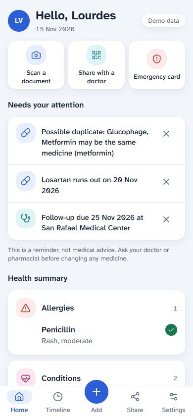
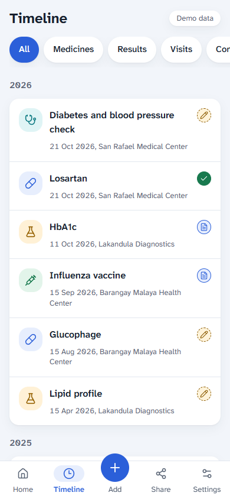
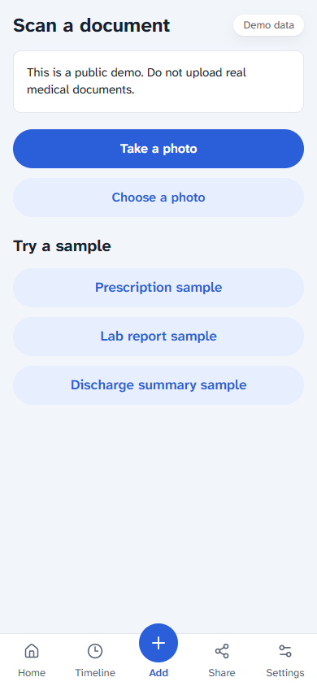
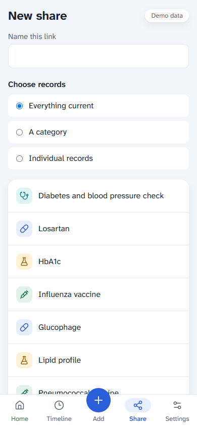

# MyHealthVault

MyHealthVault is a demo app for keeping a patient health history, reviewing document scans, and sharing selected records with a clinician.

Live link: added at release.

## Screenshots

## Install

On iPhone, open the live link in Safari, tap Share, then Add to Home Screen.

On Android, download the debug APK from GitHub Releases and install it. The builder did not run the Android build on a phone. The APK comes from the GitHub Actions workflow.

## What the demo does

Anonymous sign-in, record storage, local document reading, selected-record share links, access logs, and record verification use the app's real data flow. The sample patient, providers, and records are fictional. Clinician licence numbers are collected for the demo but are not checked against a register. The app does not give medical advice.

The PIN is only a screen lock; demo records are kept unencrypted in the browser's storage on this device, so do not enter real medical information.

## Run locally

Install Node.js 22, run `npm ci`, set `VITE_SUPABASE_URL`, `VITE_SUPABASE_ANON_KEY`, and `VITE_PUBLIC_URL` for the demo project, then run `npm run dev`. Run `npm test`, `npm run check:slop`, and `npm run test:e2e` for the checks. End-to-end tests create demo users and rows in the configured Supabase project.

## Model team

Fable 5.1 was the architect and reviewer. Sonnet 5.5 managed the work. GPT-6-Sol in Codex and Gemini 3.8 Flash in Antigravity built features. Opus worked on the security-sensitive functions.

Proposal: Project 4 of the side-project series.
